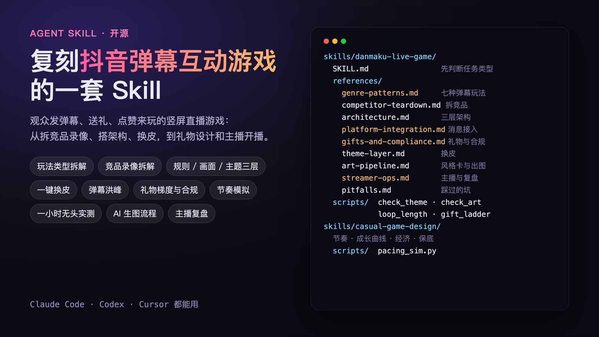
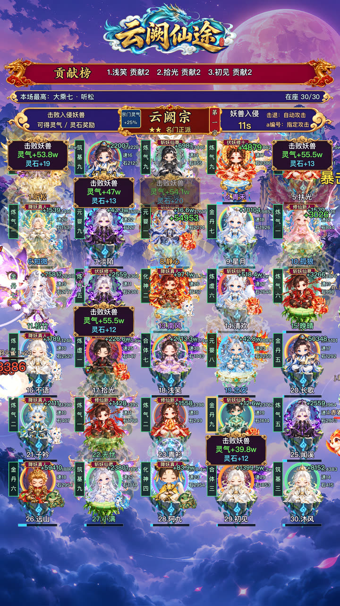
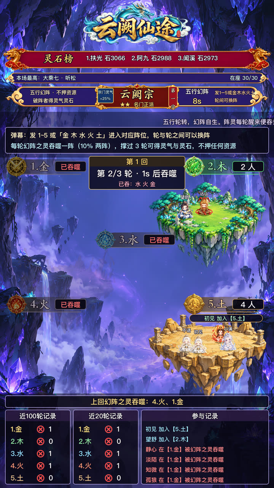
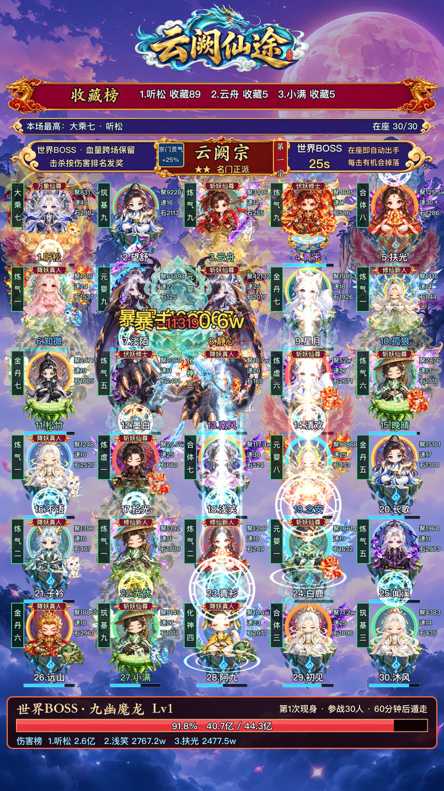
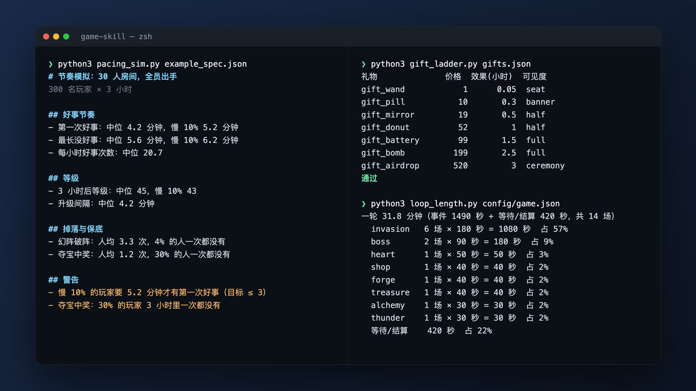

# game-skill

两个做游戏用的 Agent skill，提炼自抖音直播间的弹幕互动游戏（直播小玩法）：弹幕修仙、席位养成、弹幕打怪、阵营对战、竞速、守城这类「观众发弹幕、送礼、点赞来玩」的竖屏直播游戏，从竞品拆解、开发、换皮到开播的整套做法。

| skill | 用途 |
|---|---|
| [`danmaku-live-game`](skills/danmaku-live-game/SKILL.md) | 开发、对标、换皮直播弹幕互动游戏：玩法类型与共同骨架、竞品录像拆解、规则 / 画面 / 主题三层架构、平台消息接入与弹幕洪峰、礼物价位梯度与合规、主题层换皮（修仙版 → 上班版 …）、事件轮换、美术风格卡与生图抠图流程、无头测试与一小时实测、截图与性能验证、主播开播与数据复盘、交付文档 |
| [`casual-game-design`](skills/casual-game-design/SKILL.md) | 短平快游戏的策划与数值：体验目标、奖励节奏、成长曲线、经济投放与回收、随机与保底，并用模拟脚本量化「无聊」和「挫败」 |

两个 skill 互相引用：前者管工程和直播，后者管好不好玩。



## 效果

用这套 skill 做出来的竖屏弹幕玩法（1080×1920，Godot 4.6；画面里的观众都是本地模拟数据）。

**弹幕修仙**：30 个席位，妖兽入侵时自动 / 指定攻击，五行幻阵整屏事件，跨场血量的世界BOSS。

<p>
  
  
  
</p>

**上班摸鱼**：30 个工位，老板巡逻、甩锅对决、送礼把老板送去出差。

<p>
  
  
</p>

配套脚本的输出（节奏模拟、礼物梯度检查、一轮事件时长）：



## 内容一览

`danmaku-live-game/references/`：

| 文件 | 讲什么 |
|---|---|
| `genre-patterns.md` | 抖音弹幕玩法的共同骨架、七种常见类型的长处和风险、弹幕本身带来的约束、选类型前的六个问题 |
| `competitor-teardown.md` | 怎么看竞品录像、拆成五张表、对齐什么不对齐什么 |
| `architecture.md` | 规则 / 画面 / 主题三层、统一事件、存档、弹幕洪峰、调试工具 |
| `platform-integration.md` | 适配层、统一事件格式、去重 / 延迟 / 连击 / 断线、本地与回放、上线前清单 |
| `gifts-and-compliance.md` | 礼物价位梯度、连击与效果队列、点赞 / 关注 / 粉丝团、送礼身份、合规上的保守做法 |
| `live-stream-ux.md` | 竖屏画面布局、席位、打怪反馈、指令设计、事件设计、社交与送礼 |
| `numbers-and-pacing.md` | 一套实测过的完整数值：事件轮换、成长曲线、世界BOSS、道具、外观矩阵 |
| `theme-layer.md` | 主题文件、加载器、换皮检查清单 |
| `art-pipeline.md` | 风格卡、出图流程、尺寸档、手机视角验收 |
| `streamer-ops.md` | 开播准备、主播控制台、一场直播的结构、口播点、每场数据复盘 |
| `verification.md` | 规则测试、文案快照、截图、性能、洪峰压测、验收门槛 |
| `pitfalls.md` | 踩过的坑 |

## 目录

```
skills/<name>/
  SKILL.md        入口：什么时候用、先判断任务类型、工作流程、核心做法
  references/     分主题的详细说明，按需读取
  assets/         模板（主题加载器、主题文件骨架、礼物表示例、模拟配置示例）
  scripts/        可直接运行的检查和模拟脚本（Python 3，无第三方依赖）
```

## 安装

### Claude Code

个人级（所有项目都能用）：

```bash
git clone https://github.com/nativejie/game-skill.git ~/game-skill
mkdir -p ~/.claude/skills
ln -s ~/game-skill/skills/danmaku-live-game ~/.claude/skills/danmaku-live-game
ln -s ~/game-skill/skills/casual-game-design ~/.claude/skills/casual-game-design
```

用软链接的好处是以后 `git pull` 就能更新。也可以直接把 `skills/` 下的目录复制到 `~/.claude/skills/`，或者复制到某个项目的 `.claude/skills/`，只在那个项目里用。

### Claude.ai / Claude 桌面版

把 `skills/<name>` 目录打成 zip（zip 里第一层是 `<name>/SKILL.md`），在 Claude 设置里的 Skills 页面上传。

### 其它 Agent（Codex、Cursor 等）

skill 本身就是 Markdown 加脚本，任何 Agent 都能读。在项目的 `AGENTS.md`（或对应的规则文件）里加一句：

```markdown
做直播弹幕游戏时，先读 game-skill/skills/danmaku-live-game/SKILL.md；
定玩法和数值时，先读 game-skill/skills/casual-game-design/SKILL.md。
按其中的指引再读 references/ 里需要的文件。
```

## 搭配生图

skill 本身不绑定任何生图服务。它管的是「怎么让几十张图风格一致、能直接进游戏」：每个项目先写一张风格卡，所有提示词都从它拼，生成后统一抠图、缩放、登记、检查（见 `skills/danmaku-live-game/references/art-pipeline.md`）。真正调接口的是你项目里的一个生图脚本，接哪家由你定：

| 方式 | 说明 |
|---|---|
| **官方接口（推荐）** | OpenAI 官方图片接口，模型用 `gpt-image-2.5`，出图效果更好。 |
| 中转站 | 任何兼容 OpenAI 图片接口的中转服务都可以，把接口地址和密钥换成中转站给的即可。模型名以中转站支持的为准；效果和稳定性因站而异，先小批量试几张再批量出图。 |

几条建议：

- **密钥只放环境变量**（例如 `IMAGE_API_KEY`，中转站再加一个 `IMAGE_API_BASE`），不要写进代码、配置文件或提交记录。
- 在项目的 `AGENTS.md` / `CLAUDE.md` 里写清楚用哪个脚本、哪个模型、密钥读哪个环境变量，Agent 就会照着出图，不会自己去找密钥。
- 抠图素材按风格卡的 `sprite_rules` 要求纯色平涂底，再用项目的抠图脚本去底，不同接口出的图走同一套流程。
- 每批记下实际提示词和图片的 SHA-256，换接口或重画时能对上。

## 脚本

```bash
# 主题层检查：代码里用到的文案 key 是否都在主题文件里、有没有没填上的 {占位}；跨名字表重名只警告
python3 skills/danmaku-live-game/scripts/check_theme.py <项目目录>

# 美术检查：没登记进美术清单的图、没缩放到清单高度的图、超大的图
python3 skills/danmaku-live-game/scripts/check_art.py <美术目录> <美术清单.json>

# 一轮事件多长、每个事件占多少时间
python3 skills/danmaku-live-game/scripts/loop_length.py <项目>/config/game.json

# 礼物梯度：效果和可见度是否随价格上升、有没有超过强度上限、有没有入门档
python3 skills/danmaku-live-game/scripts/gift_ladder.py skills/danmaku-live-game/assets/gifts_example.json

# 节奏模拟：几百个玩家玩几小时，报告第一次好事、最长空窗、升级间隔、货币余额、保底触发
python3 skills/casual-game-design/scripts/pacing_sim.py skills/casual-game-design/assets/example_spec.json
```

## 说明

- 示例数值和代码模板来自 Godot 4.6、竖屏 1080×1920 的实际开发，代码是 GDScript，方法与引擎无关。
- 平台接口、礼物价格、审核规则会变，文中只讲结构和设计取舍；接入时以平台当期的开放平台文档和规范为准。
- 美术风格不通用：每个项目先写自己的风格卡（`references/art-pipeline.md`），里面列的风格卡只作参照。
- 数值按项目目标调整后再用；模拟结果是近似，真实项目里还要用引擎自己的无头实测核对一次。
